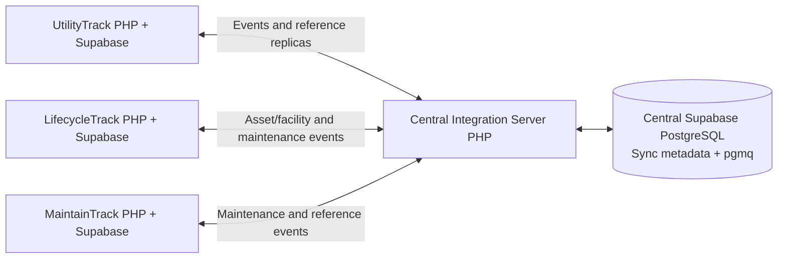
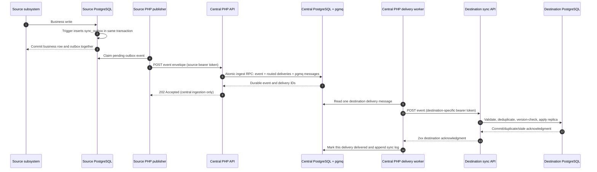

# Barangay Integrated Management System: Centralized Synchronization Architecture

**Status:** Phase 1 architecture baseline  
**Scope:** UtilityTrack, LifecycleTrack, MaintainTrack, and the Central Integration Server  
**Authority:** This document translates the project request and supplied schema context into the implementation contract. Existing subsystem documents marked draft/preparation are reference material; they do not supersede this contract.

## 1. Goals and invariants

- Each subsystem remains authoritative for the business data listed in the ownership matrix below.
- The Central Server stores event envelopes, routes, delivery state, registries, and operational logs. It is not the authoritative store for bills, assets, facilities, or maintenance operations.
- Replicas and reference data are stored separately from authoritative subsystem records. A received event must never update an owned record in another subsystem.
- Source business writes and their outbox entries commit in the same PostgreSQL transaction. Network delivery happens asynchronously after commit.
- Every event is routed independently to each configured destination. Delivery success, retry, or dead-letter state is tracked per event and destination.
- Event ingestion acknowledgment means the Central Server durably recorded the event and its destination deliveries. Destination acknowledgment means the receiver durably recorded or idempotently recognized that event.
- Duplicate, delayed, retried, and out-of-order events must not cause duplicate side effects or roll back newer replica state.

## 2. System context



All application-to-application calls use authenticated REST over HTTPS when deployed across the LAN. Each installation uses the Central Server computer's reachable LAN address; `localhost` is valid only when both processes are on the same computer. Each subsystem retains its own Supabase project and keys. A subsystem's Supabase key is never sent to another subsystem or to the Central Server.

## 3. Ownership and synchronization matrix

| Event/data | Authoritative owner | Routed destination(s) | Destination storage/behavior |
|---|---|---|---|
| Facility and equipment reference snapshots, changes, retirement/disposal | LifecycleTrack | MaintainTrack, UtilityTrack | Read-only reference replicas/mappings; used to associate maintenance and utility records |
| Maintenance procedures, work orders, inspections, repair/completion results | MaintainTrack | LifecycleTrack | Maintenance history replica; must not edit LifecycleTrack equipment/facility master fields |
| Utility bills, consumption, billing history, and payment state | UtilityTrack | LifecycleTrack; MaintainTrack only when its route is enabled | Utility reference/history replica; no changes to UtilityTrack records |
| Utility-relevant facility/equipment references | LifecycleTrack | UtilityTrack | Reference replica and selectable facility association |
| Integration event, route, delivery, registry, and synchronization status | Central Server (integration metadata only) | Central operations | Central sync tables and pgmq; no subsystem business ownership |

`UtilityTrack → MaintainTrack` is an optional route controlled by `sync_routes` and disabled until explicitly enabled. The route payload is restricted to fields needed for the configured maintenance use case. No subsystem-to-subsystem shortcut bypasses the Central Server.

### Ownership boundaries

- **LifecycleTrack IDs:** `facilities.id` and `equipment.id` are bigint source identifiers. They remain encoded as strings in event envelopes and destination mappings. Equipment events include the LifecycleTrack facility ID when assigned.
- **MaintainTrack IDs:** its `facilities.facility_id` and `equipment.equipment_id` remain local UUIDs. MaintainTrack keeps an explicit mapping from LifecycleTrack `(record_type, source_id)` to its local UUID, or an unresolved reference when no local row exists. A remote reference never becomes a MaintainTrack primary key.
- **UtilityTrack association:** current bill tables have free-text `location`; the implementation adds a nullable LifecycleTrack facility reference to bill records. It is an external reference, not a cross-project foreign key. Existing text locations are not automatically treated as unique facility identifiers.
- **Deletion:** a source deletion/retirement emits a versioned tombstone. Receivers mark the replica/reference inactive and retain the source key and event version for replay and reconciliation.

## 4. Event processing and delivery



If a destination is offline or returns a retryable error, only its delivery is rescheduled. Other destination messages continue independently. Exhausted deliveries are copied to `sync_dead_letters`, logged with their failure reason, and removed from the active pgmq queue. Replay creates/requeues the failed delivery without changing the source event identity.

### Canonical event envelope

```json
{
  "event_id": "uuid",
  "source_system": "LifecycleTrack",
  "event_type": "lifecycle.equipment.upserted",
  "record_type": "equipment",
  "source_id": "42",
  "source_version": 7,
  "occurred_at": "2026-11-09T08:30:00Z",
  "operation": "upsert",
  "schema_version": 1,
  "correlation_id": "uuid-or-null",
  "payload": {"id": "42", "facility_id": "5", "name": "Generator", "status": "Serviceable"}
}
```

- `event_id` is generated once in the source outbox and remains unchanged across retries and destinations.
- `source_version` is a positive, monotonically increasing integer per source record. Receivers compare it with the version already processed for that source key. Timestamps are audit data, not the ordering authority.
- The source key is `(source_system, record_type, source_id)`. The outbox also enforces unique `event_id`; Central Server ingestion is idempotent for repeated `event_id` values.
- Event type names use stable, lower-case dotted names. Initial types are `lifecycle.facility.upserted`, `lifecycle.facility.deleted`, `lifecycle.equipment.upserted`, `lifecycle.equipment.deleted`, `maintenance.work_order.upserted`, `maintenance.inspection.recorded`, `maintenance.repair.recorded`, `maintenance.result.recorded`, `utility.bill.upserted`, `utility.bill.deleted`, `utility.payment.updated`, and `utility.consumption.recorded`.
- Unknown event types, invalid source/type combinations, malformed IDs, unsupported schema versions, and payloads outside the event allowlist are rejected before fan-out.
- Payloads contain only operational fields required by destinations. Do not transmit passwords, Supabase keys, session/user identifiers, personal account-holder data, images, storage paths, or free-form notes unless a later field-level contract explicitly approves them.

### Initial allowlisted payload fields

| Event family | Fields sent |
|---|---|
| Lifecycle facility | source ID, name, location, category, status/lifecycle stage, condition, department, acquisition date/year, criticality, updated/version data |
| Lifecycle equipment | source ID, LifecycleTrack facility ID, asset tag, name, category, brand/model, location, status/lifecycle stage, condition, quantity, acquisition date/year/cost, criticality, updated/version data |
| Maintenance work order/result | MaintainTrack request/work-order ID, LifecycleTrack facility/equipment reference, status, priority, maintenance type, key dates, completion outcome, labor/parts totals where used, sanitized failure cause/result, source version |
| Utility bill/consumption | UtilityTrack bill ID, utility type, LifecycleTrack facility ID, billing period/date, consumption, charges/total, due date, status, payment state/date, source version |
| Utility payment | UtilityTrack bill ID, LifecycleTrack facility ID, payment status/date and amount; exclude payment reference and payer identity by default |

The detailed executable field maps and constraints belong in the Phase 2 schemas/contracts review. This baseline intentionally excludes unneeded personal data and binary documents.

## 5. Central processing model

1. A source trigger/RPC inserts an immutable event into that subsystem's `sync_outbox` as part of the business transaction.
2. A PHP publisher claims eligible outbox rows and posts the envelope to the Central Server. A source row is marked delivered only after the Central Server returns a durable `202` acknowledgment; transient errors retain the event for retry.
3. A Central Server RPC validates the source identity, inserts or recognizes the event in `sync_events`, resolves active matching `sync_routes`, inserts one `sync_deliveries` row per target, and sends one pgmq transport message per delivery atomically.
4. A PHP central worker handles each destination delivery independently. It authenticates to that destination's API and updates only that delivery's attempts, status, response, and next retry time.
5. Destination APIs authenticate the Central Server, insert `event_id` into `processed_sync_events`, compare source version, and update only a replica or external-ID mapping in the same database transaction.
6. `sync_logs` records operational transitions. A failed delivery reaching its configured maximum attempts is archived to `sync_dead_letters`; operators can inspect and replay it.

The required Central Server tables are `sync_events`, `sync_deliveries`, `sync_routes`, `sync_registry`, `sync_logs`, and `sync_dead_letters`. Each spoke has `sync_outbox` and `processed_sync_events`; replica/reference tables are additional and must remain distinct from owned business tables. `sync_registry` records registered subsystem identity, API base URL, health/last-seen status, and credential reference metadata; secret values remain in server environment configuration, never in the database as plaintext.

## 6. Retry, outage, conflict, and reconciliation behavior

- **Source offline from Central:** outbox event remains pending and retries with bounded exponential backoff. The business transaction succeeds independently of Central availability.
- **Destination offline:** only that destination delivery retries. Other destinations continue to receive their own messages.
- **Duplicate event:** source publisher retries safely; Central returns the existing durable event/delivery state. Destination returns success for an already processed event without repeating side effects.
- **Out-of-order event:** destination records/acknowledges the event as stale but does not replace a replica with an older source version.
- **Dead letter:** retain event, destination, attempt count, timestamps, and sanitized error. Replay keeps the event ID and can be audited.
- **Initial bootstrap:** use source-side backfill publishers to emit current snapshots through the same event contracts. A checkpoint makes the process resumable; live writes continue into the transactional outbox.
- **Periodic reconciliation:** source workers compare authoritative IDs/versions with accepted event/replica checkpoints and re-enqueue missing or stale snapshots. Reconciliation does not mutate the authoritative data from another subsystem.
- **Retention:** event and log retention windows, dead-letter retention, and pruning are deployment configuration decisions to be finalized with the Phase 2 schema before production rollout.

## 7. API contract outline

| Endpoint | Caller | Purpose | Success meaning |
|---|---|---|---|
| `GET /api/v1/health` | Monitoring | Liveness/readiness and dependency status | API reports whether its database/queue dependency is available |
| `POST /api/v1/events` | UtilityTrack, LifecycleTrack, MaintainTrack | Authenticated event ingestion | `202` means event and routed deliveries are durable in the Central Server |
| `POST /api/v1/sync/events` | Central Server worker | Authenticated destination event application | `200`/`202` means applied, duplicate, or stale event was durably recognized |
| `GET /api/v1/sync/status/{event_id}` | Authorized subsystem/monitor | Read event and per-destination delivery status | Returns delivery states only; no business-data query surface |
| `POST /api/v1/admin/dead-letters/{delivery_id}/replay` | Central operator | Requeue a selected failed delivery | `202` means replay was queued |

The existing type-specific `/api/v1/ingest/...` routes remain during migration as compatibility adapters that create canonical events. They are retired only after all senders are switched and reconciliation confirms no legacy-only traffic. Every API has bounded request size, JSON object validation, per-source/per-destination bearer authentication, explicit method/status behavior, and generic client errors; secrets and sensitive payload details are never returned in errors.

## 8. Implementation phases and acceptance gates

| Phase | Main result | Gate before next phase |
|---|---|---|
| 1. Architecture (this document) | Context, flows, ownership matrix, event/API baseline, recovery model | Review all five flows, IDs, ownership, and privacy baseline |
| 2. Database schemas | Executable migrations for central and three spokes; compatibility/backfill strategy | Apply to disposable Supabase projects; verify constraints, policies, atomic RPC fan-out, and preservation of existing central tables |
| 3. Source transactional outboxes | Trigger/RPC event capture and spoke PHP publishers | Verify business write and outbox commit/rollback together; verify offline retry |
| 4. Central integration API | Authenticated canonical ingestion, validation, legacy adapters | Verify source/type authorization, payload allowlists, size limits, duplicate ingestion, and durable 202 |
| 5. Queue workers | Independent destination delivery, retry, acknowledgment, dead letters/replay | Simulate one destination outage while another succeeds; verify retry/backoff and replay |
| 6. Destination APIs | Idempotent replica/mapping updates and processed-event records | Verify duplicate/stale/tombstone behavior and no writes to authoritative rows |
| 7. Backfill and reconciliation | Resumable bootstrap and recurring drift repair | Verify complete source ID coverage, checkpoints, and safe re-enqueue |
| 8. Monitoring dashboard | Central event/delivery/log/dead-letter views and operator actions | Verify metrics/status against controlled queue scenarios and admin authorization |
| 9. Deployment and operational runbooks | LAN, HTTPS, secrets, Supabase setup, PHP workers, recovery and rollback | Follow clean deployment and restore/replay procedures in a staging environment |

At each gate, implementation pauses for project-owner review before the following phase begins.

## 9. Schema compatibility notes from supplied context

- The current Central Server has `central_records` constrained to UtilityTrack/LifecycleTrack and three `central_*` snapshot tables. Migrations must preserve these tables and their rows; the new integration ledger supplements rather than silently replaces the snapshots.
- LifecycleTrack's `facilities` and `equipment` use bigint identity keys; equipment optionally references a facility. Existing `maintenance_records.external_id` and `external_asset_tag` can inform migration but do not replace the canonical event key.
- MaintainTrack's facility/equipment identifiers are UUIDs and its maintenance operations use UUID request/equipment references. Mapping rows must bridge to LifecycleTrack IDs without changing those primary keys or overwriting the local records.
- UtilityTrack bills use bigint IDs and currently have `location` text. An explicit nullable external LifecycleTrack facility ID is required for reliable association; migration must leave existing bill rows valid and unmapped until reviewed/matched.
- Supplied schema excerpts are contextual snapshots, not deployment-ready SQL. Phase 2 must inspect live Supabase schemas, RLS, grants, API behavior, and current migrations before producing executable scripts.

